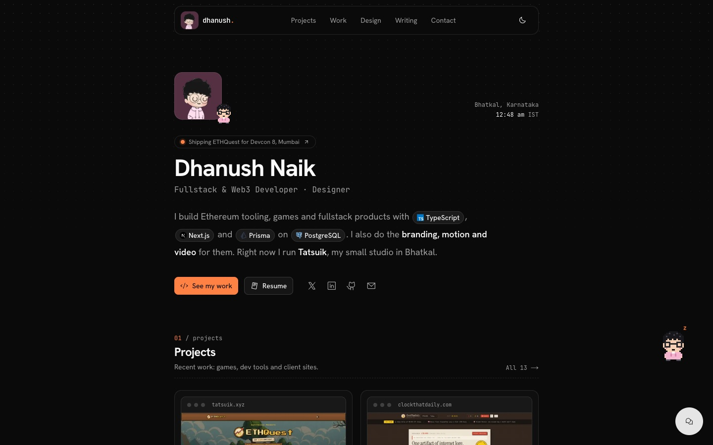
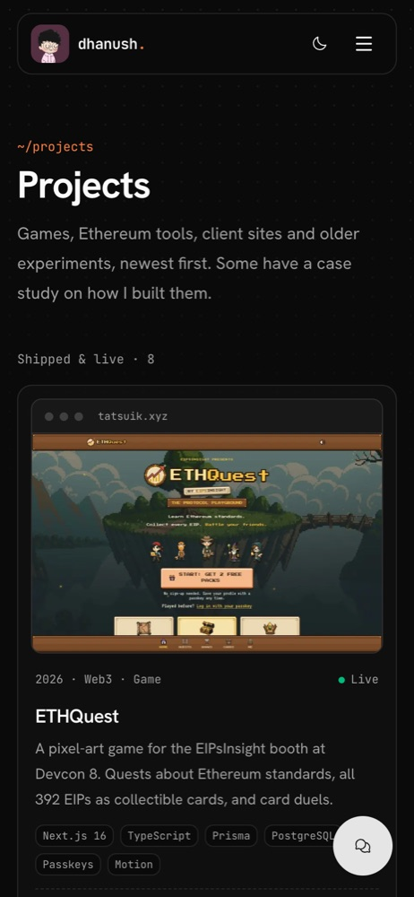

# dhanush.

My personal site. I'm Dhanush Naik, a fullstack and Web3 developer who also does design and video. I run [Tatsuik](https://www.tatsuik.com/), a small studio in Bhatkal, Karnataka.

**Live:** [dhanushlnaik.vercel.app](https://dhanushlnaik.vercel.app)



<p align="center">
  
</p>

## What's on it

- **Projects**: games, Ethereum tools and client sites, each with a screenshot. Some have a full case study.
- **Work**: Tatsuik, Avarch, EtherWorld, CogniMuse and the Discord communities I help run.
- **Writing**: posts about things I've built, hackathons and making a short film.
- **Design**: posters, photo edits and videos.
- **Bit**: a small pixel version of me that follows your cursor on desktop and falls asleep if you stop moving.
- A chat box (Gemini) that answers questions about my work, and a contact form that sends to Telegram.

## Stack

Next.js 15 (App Router), React 19, TypeScript, Tailwind CSS v4, MDX through `next-mdx-remote`, shadcn/ui, Motion and Lenis. Hosted on Vercel.

## Running it locally

```bash
pnpm install
pnpm dev
```

Then open [localhost:3000](http://localhost:3000).

To run the chat and contact form locally, add these to `.env.local`:

| Variable | What it's for |
| --- | --- |
| `GEMINI_API_KEY` | Chat assistant (`/api/chat`) |
| `TELEGRAM_BOT_TOKEN`, `TELEGRAM_CHAT_ID` | Contact form messages (`/api/contact`) |
| `NEXT_PUBLIC_UMAMI_ID`, `NEXT_PUBLIC_UMAMI_SRC` | Analytics (optional) |
| `NEXT_PUBLIC_URL` | Site URL used in metadata |

## Editing content

Almost all the text lives in `src/config` and `src/data`, so most updates don't touch components.

| What | Where |
| --- | --- |
| Hero text, "currently" pill, social links | `src/config/Hero.tsx` |
| About, `/now` list, stats | `src/config/About.tsx` |
| Studio services | `src/config/Studio.ts` |
| Work history | `src/config/Experience.tsx` |
| Project cards | `src/config/Projects.tsx` |
| Project case studies | `src/data/projects/<slug>.mdx` |
| Blog posts | `src/data/blog/<slug>.mdx` |
| Journey timeline | `src/data/journey/journey.mdx` |
| Design and video gallery | `src/data/graphicsVideos.ts` |
| Footer links | `src/config/Footer.tsx` |
| Colours | `--brand` and `--brand-soft` in `src/app/globals.css` |
| Bit (the mascot) | `src/components/common/PixelBuddy.tsx`, turn off in `src/config/Buddy.ts` |
| Favicons | generated by `node scripts/make-icons.mjs` from Bit's pixel grid |

### Adding a project

1. Save a 1440×900 screenshot to `public/project/<name>.jpg`.
2. Add an entry to the top of `src/config/Projects.tsx`. Set `featured: true` to show it on the home page.
3. For a case study, set `details: true` and create `src/data/projects/<slug>.mdx`. The slug has to match `projectDetailsPageSlug`, or the page 404s.

To take the screenshot with Chrome:

```bash
"/Applications/Google Chrome.app/Contents/MacOS/Google Chrome" --headless=new \
  --window-size=1440,900 --virtual-time-budget=12000 \
  --screenshot=shot.png https://example.com
```

Then convert it to JPEG (`sips -s format jpeg shot.png --out public/project/<name>.jpg`).

### Writing a post

Create `src/data/blog/<slug>.mdx` with this frontmatter:

```yaml
---
title: 'Post title'
description: 'One line for the blog list and link previews.'
image: '/blog/<slug>.png'
tags: ['nextjs', 'projects']
date: '2026-11-06'
isPublished: true
---
```

MDX files can't contain JavaScript expressions (`{...}`) because `next-mdx-remote` v6 blocks them by default. Plain Markdown is fine.

## Contact

[dhanushlnaik@gmail.com](mailto:dhanushlnaik@gmail.com) · [X](https://x.com/iamdhanushlnaik) · [LinkedIn](https://www.linkedin.com/in/dhanushlnaik/) · [Tatsuik](https://www.tatsuik.com/)
